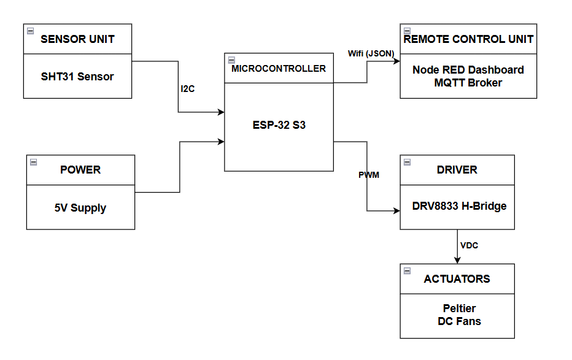
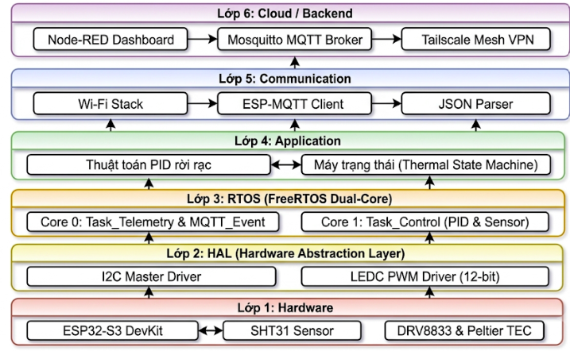

# Hệ thống Điều khiển Nhiệt độ IoT (IoT Temperature Control System)


-orange)


Giải pháp thiết bị biên, ứng dụng hệ điều hành thời gian thực FreeRTOS trên vi điều khiển ESP32-S3 để thực thi thuật toán điều khiển PID hai chiều (làm nóng / làm lạnh) với sò nhiệt peltier. Kết hợp cùng hạ tầng mạng riêng ảo (Mesh VPN) thông qua dịch vụ Tailscale, hệ thống cho phép giám sát và điều chỉnh nhiệt độ từ xa qua internet mà không cần mở cổng Port Forwarding trên router vật lý.

---

## Mô hình Phần cứng



---

## Tính năng nổi bật

* **Điều khiển thời gian thực đa lõi:** Tối ưu hóa kiến trúc 2 nhân Xtensa LX7 của ESP32-S3:
  * **Core 0 (`Task_Telemetry` & `MQTT_Event`):** Phụ trách kết nối với mạng Wi-Fi, duy trì phiên MQTT và đóng gói chuỗi JSON gửi dữ liệu định kỳ.
  * **Core 1 (`Task_Control`):** Đọc cảm biến SHT31 qua giao thức I2C và tính toán vòng lặp điều khiển PID với chu kỳ lấy mẫu cố định ($\Delta t = 1.0\text{s}$), giúp giảm thiểu trễ nhịp bởi tác vụ mạng.
* **Thuật toán PID vùng biên:**
  * **Ngoài ngưỡng sai số $\pm 2.0^\circ\text{C}$:** Hệ thống sẽ kích hoạt công suất tối đa ($\pm 4095$) và xóa tích phân để tăng tốc độ đáp ứng nhiệt.
  * **Trong ngưỡng $\pm 2.0^\circ\text{C}$:** Chuyển sang điều khiển PID kết hợp cơ chế **Anti-windup** (giới hạn khâu tích phân trong khoảng $[-200, 200]$) và tự động reset tích phân khi nhiệt độ vượt qua điểm mong muốn.
* **Bảo vệ phần cứng bất đồng bộ:**
  * **Chống sốc nhiệt đảo chiều:** Tự động ngắt PWM và đếm lùi an toàn trong giới hạn 5 giây trước khi mạch cầu H băm xung đảo chiều dòng điện giữa hai trạng thái NÓNG (HEAT) $\leftrightarrow$ LẠNH (COOL) mà không gây nghẽn luồng truyền thông.
  * **Cơ chế an toàn cho cảm biến:** Tự động giảm PWM về 0 và xóa lỗi tích phân ngay khi giao tiếp I2C với cảm biến SHT31 bị gián đoạn.
* **Truyền thông tin cậy & NAT:** Sử dụng giao thức MQTT với mức QoS 1 chạy trên dịch vụ nền tảng Tailscale VPN (giao thức WireGuard), cấp phát địa chỉ IP tĩnh nội bộ (100.x.x.x) cho IoT Gateway.

---

## Cấu trúc Phần cứng & Sơ đồ Đấu nối

### 1. Danh mục linh kiện
| Thành phần | Thiết bị / Module | Thông số / Vai trò |
| :--- | :--- | :--- |
| **Vi điều khiển (MCU)** | ESP32-S3 DevKit | Dual-core 240MHz, tích hợp Wi-Fi |
| **IoT Gateway** | Raspberry Pi 4 | Chạy Mosquitto MQTT Broker, Node-RED & Tailscale |
| **Cảm biến nhiệt độ** | SHT31 | Giao tiếp I2C (Địa chỉ `0x44`, tốc độ 100 kHz) |
| **Mạch công suất** | Cầu H DRV8833 | Băm xung PWM 18 kHz, độ phân giải 12-bit (0 - 4095) |
| **Cơ cấu chấp hành** | Sò nóng lạnh peltier (TEC) | Điện áp 5V, kết hợp quạt và khối nhôm tản nhiệt |

### 2. Sơ đồ chân GPIO (Pinout Mapping)
| Ngoại vi | Tín hiệu | Chân ESP32-S3 | Mô tả kết nối |
| :--- | :--- | :---: | :--- |
| **SHT31 Sensor** | `SDA` | **GPIO 8** | Đường dữ liệu I2C (`I2C_NUM_0`) |
| **SHT31 Sensor** | `SCL` | **GPIO 9** | Đường xung nhịp I2C (`I2C_NUM_0`) |
| **DRV8833 Driver** | `IN1` (COOL) | **GPIO 4** | Kênh PWM 0 (`LEDC_CHANNEL_0`) - Chế độ làm lạnh |
| **DRV8833 Driver** | `IN2` (HEAT) | **GPIO 5** | Kênh PWM 1 (`LEDC_CHANNEL_1`) - Chế độ làm nóng |

---

## Kiến trúc Phần mềm

Hệ thống được thiết kế theo mô hình phân lớp gồm 6 tầng độc lập:



---

### Thông số bộ điều khiển PID mặc định
Được cấu hình trực tiếp trong `main/main.c`:
* Hệ số tỉ lệ ($K_p$): 2000.0
* Hệ số tích phân ($K_i$): 25.0
* Hệ số vi phân ($K_d$): 5.0
* Nhiệt độ đặt mặc định (Setpoint): 30.0 °C (Dải cho phép điều chỉnh: 10.0 °C – 40.0 °C)
* Dải đầu ra PWM: [-4095, +4095]

---

## Cấu trúc Thư mục

```text
Temp_Control/
├── .devcontainer/          # Cấu hình môi trường Docker & QEMU cho VS Code
├── components/
│   └── ssd1306/            # Thư viện driver màn hình OLED SSD1306/SH1106 (I2C/SPI)
├── img/
│   └── hardware_setup.png  # Hình ảnh lắp đặt phần cứng thực tế
├── main/
│   ├── CMakeLists.txt      # Khai báo các module phụ thuộc cho nhánh main
│   ├── idf_component.yml   # Quản lý thư viện espressif/mqtt
│   ├── Kconfig.projbuild   # Menu cấu hình MQTT Broker & Topics
│   └── main.c              # Mã nguồn chính (PID, SHT31, DRV8833, MQTT, FreeRTOS)
├── CMakeLists.txt          # CMake cấu hình toàn dự án
├── sdkconfig.defaults      # Các thiết lập mặc định cho target ESP32-S3
└── README.md               # Tài liệu hướng dẫn dự án
```

---

## Hướng dẫn Cài đặt & Biên dịch

### 1. Yêu cầu hệ thống
* **ESP-IDF:** Phiên bản `v5.x` hoặc `v6.x` (Hỗ trợ mở trực tiếp qua Docker Container với `.devcontainer`).
* **MQTT Broker:** Mosquitto đang hoạt động trên Raspberry Pi hoặc máy chủ có cài đặt Tailscale.

### 2. Thiết lập mạng Wi-Fi & MQTT
Mở giao diện cấu hình của ESP-IDF từ terminal:
```bash
idf.py menuconfig
```
* **Cấu hình Wi-Fi:** Truy cập `Example Connection Configuration` $\rightarrow$ Điền **WiFi SSID** và **WiFi Password**.
* **Cấu hình MQTT:** Truy cập `Temp Control System Configuration` $\rightarrow$ Chỉnh sửa:
  * `MQTT Broker URL` (Mặc định: `mqtt://100.64.0.1:1883`)
  * `MQTT Publish Topic` (Mặc định: `hethong/temp_control`)
  * `MQTT Subscribe Topic` (Mặc định: `hethong/set_from_web`)

### 3. Biên dịch, Nạp code và Giám sát Log
```bash
# Biên dịch toàn bộ dự án
idf.py build

# Nạp chương trình vào ESP32-S3 và mở Serial Monitor (thay COMx bằng cổng thực tế trên máy bạn)
idf.py -p COMx flash monitor
```

---

## Đặc tả Giao thức MQTT

| Chiều dữ liệu | Topic Mặc định | QoS | Định dạng Payload | Mô tả chi tiết |
| :--- | :--- | :-: | :--- | :--- |
| **Publish** *(ESP32 -> Broker)* | `hethong/temp_control` | 1 | JSON | Gửi dữ liệu giám sát mỗi 1s/lần. Trạng thái `mode` gồm: "HEAT", "COOL" hoặc "OFF". |
| **Subscribe** *(Web -> ESP32)* | `hethong/set_from_web` | 1 | Chuỗi số thực (`float`) | Nhận giá trị nhiệt độ mục tiêu từ dashboard trên web (trong khoảng [10.0 - 40.0], với độ lệch tối thiểu > 0.1 °C). |

**Ví dụ bản tin JSON Telemetry (`hethong/temp_control`):**
```json
{
  "temp": 28.45,
  "set": 30.0,
  "pwm": 3100,
  "mode": "HEAT"
}
```

**Ví dụ bản tin cài đặt Setpoint (`hethong/set_from_web`):**
```text
26.5
```

---